<div align="center">


### Your AI backend, built from a sentence.

Describe what you want. Drop in documents, links, voice memos and API specs.<br>
Interlock builds the flow, tests it, fixes it, and hands you an API, an MCP server and a chat widget.

<p>
  
  
  
  
  
</p>

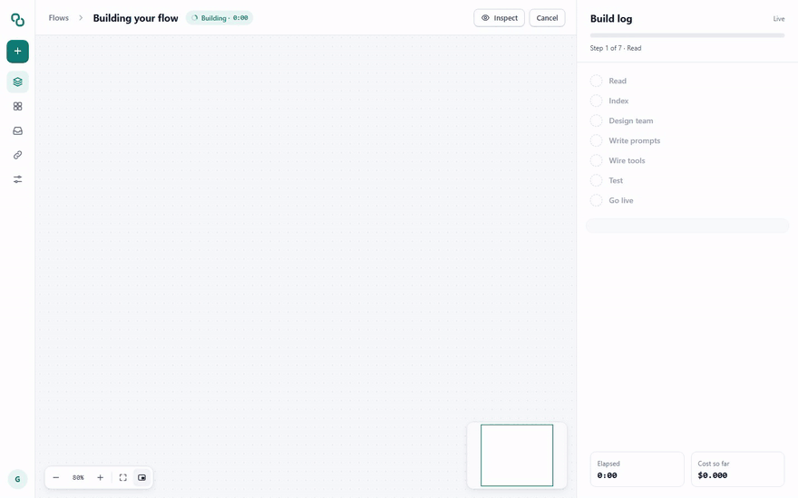

<sub>A real build, replayed: read the help center and documents → design a router and two agents → write the prompts → wire the API tools → run 30 tests → fix two → go live.</sub>

</div>

---

## ✨ What it does

|   |   |
|---|---|
| 🗣️ **Describe it** | Type or say a goal. Attach PDFs, Word files, links, voice memos and OpenAPI specs, and mark each one as *knowledge* (to answer from) or *instructions* (rules to follow). |
| 🧠 **Interlock designs it** | NVIDIA Nemotron turns the goal into a flow on a canvas: triggers, a knowledge base, routers, agents with tools, safety rules, approvals and outputs, with every prompt written. |
| 🧪 **It tests and fixes itself** | Every build runs on sample data. AI apps also get a generated test suite, judged against their own documents. Failures go back to the architect, which fixes the flow and runs it again. |
| ✏️ **You can change anything** | Each step has a settings form, live input and output previews, and a "Replace with…" picker. Or ask in plain words: *"hand refunds over $100 to a person"* becomes a diff you accept or reject. |
| 🚀 **Ship it anywhere** | AI apps become an **OpenAI-compatible API** (streaming), an **MCP server**, a **one-line chat widget** and an `INTERLOCK.md` integration guide. Automations run on schedules, webhooks and app events. |
| 🤖 **Let your coding agent drive** | A workspace MCP server gives Claude Code or Codex the whole app: build, refine, test, publish, run and approve. |

## 🎬 See it work

<table>
<tr>
<td width="50%"><b>Chat with your app in the Playground</b><br><sub>Routed to the billing agent, looked up the customer and invoice, cited the policy.</sub><br>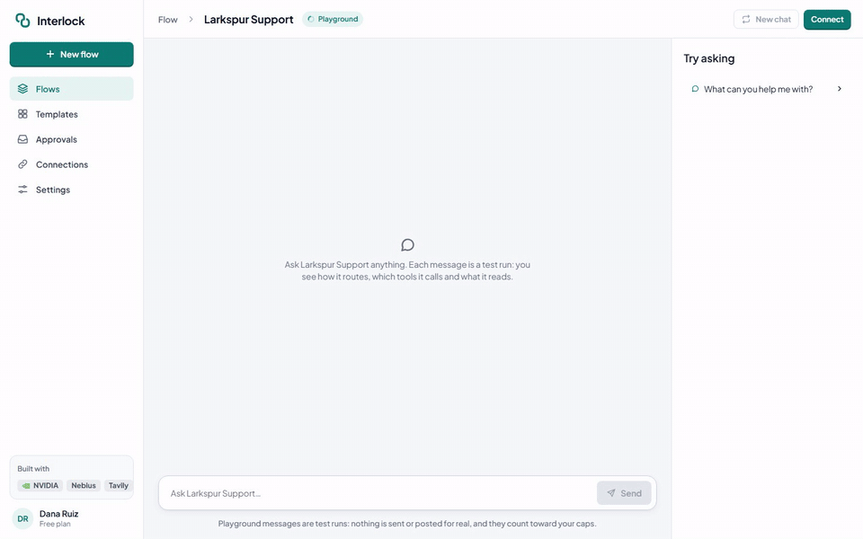</td>
<td width="50%"><b>Watch an automation run</b><br><sub>Weekly product promos: three newest products → scripts → videos → waiting for your approval.</sub><br>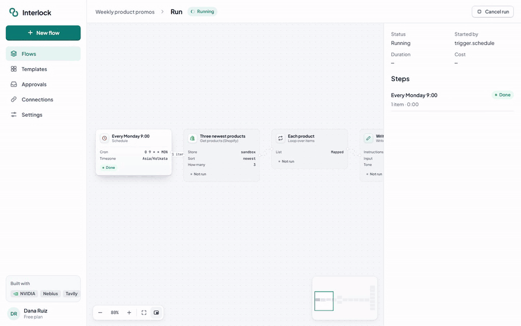</td>
</tr>
</table>

## 🖼️ Screens

<table>
<tr>
<td width="50%">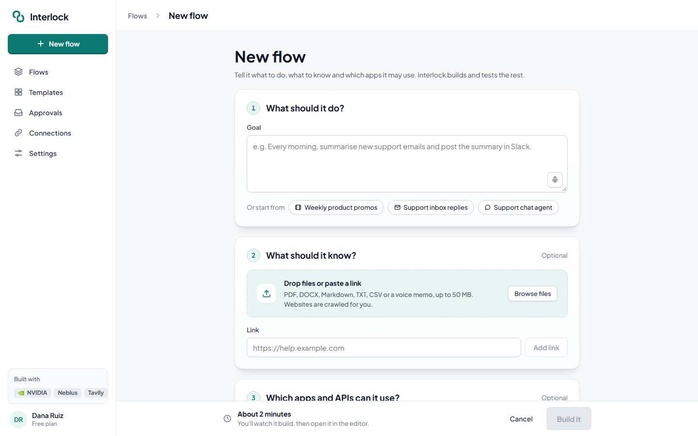<br><sub><b>New flow.</b> A sentence, some files, and go.</sub></td>
<td width="50%">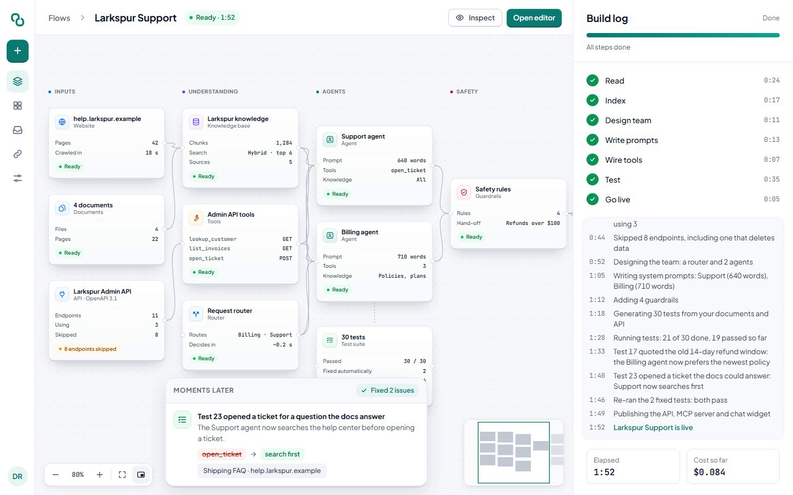<br><sub><b>Build.</b> The canvas fills in from real build events, then tests and fixes.</sub></td>
</tr>
<tr>
<td>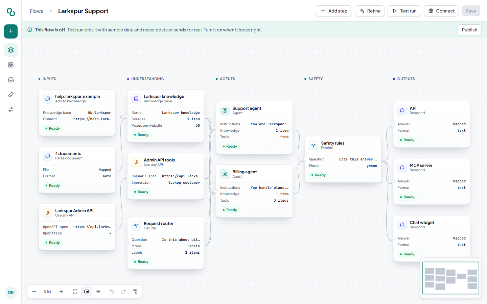<br><sub><b>Editor.</b> Inputs, knowledge, agents, safety and outputs, all editable.</sub></td>
<td>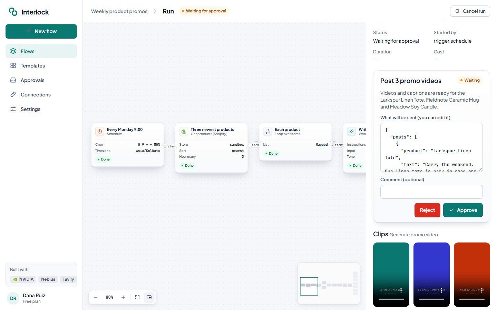<br><sub><b>Runs.</b> Every step's data, plus human approvals before anything is sent.</sub></td>
</tr>
<tr>
<td>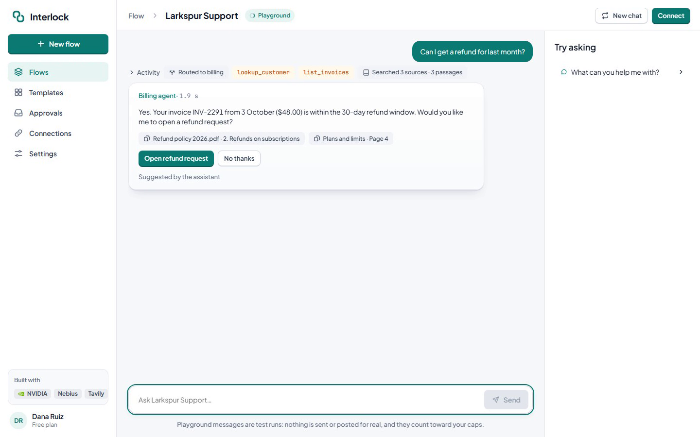<br><sub><b>Playground.</b> Test runs never send or post for real.</sub></td>
<td>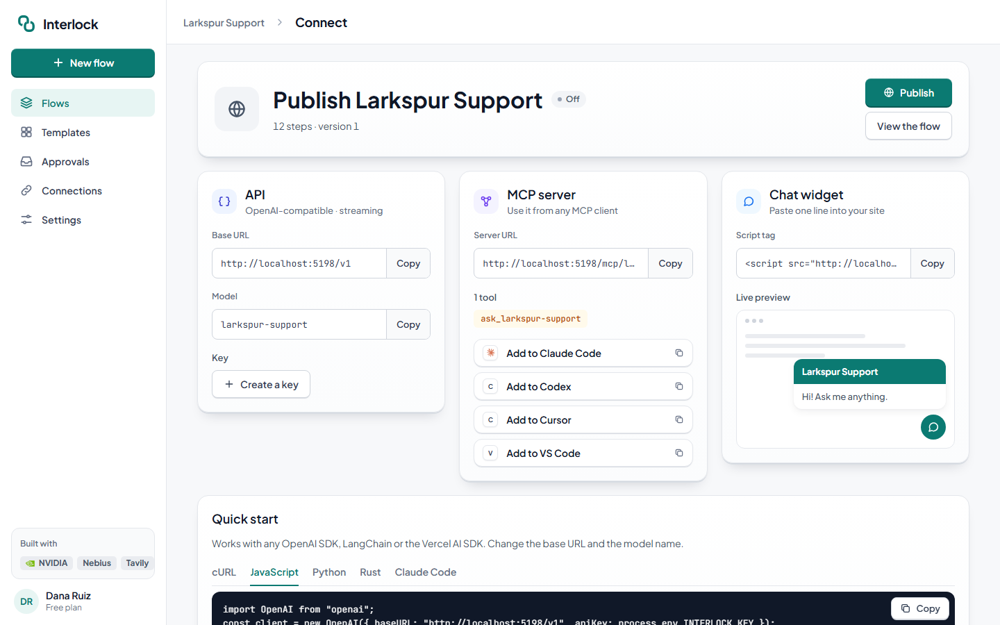<br><sub><b>Publish.</b> API, MCP (Claude Code, Codex, Cursor, VS Code) and widget.</sub></td>
</tr>
<tr>
<td>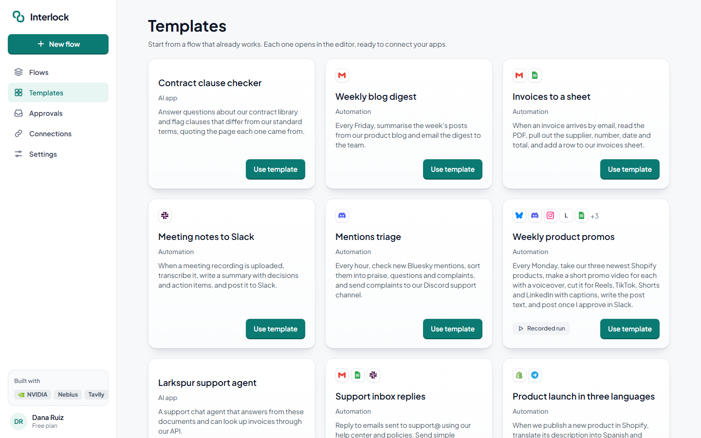<br><sub><b>Templates.</b> Ten ready-made flows to start from.</sub></td>
<td>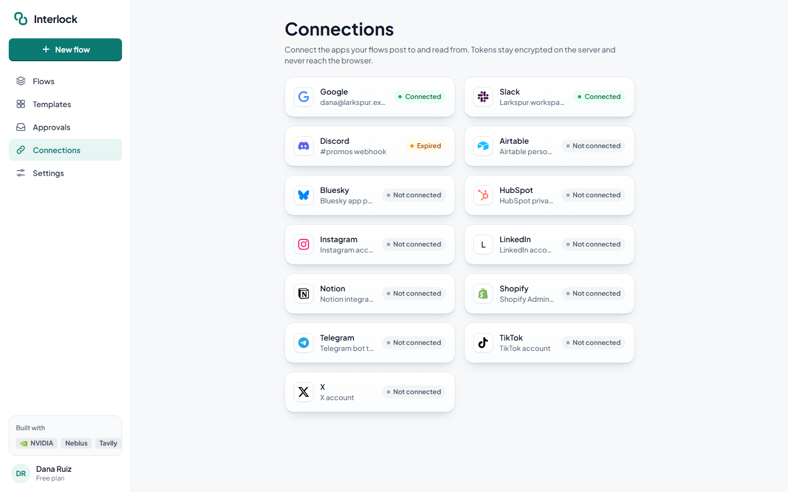<br><sub><b>Connections.</b> Google sign-in, bot tokens and API keys, encrypted at rest.</sub></td>
</tr>
</table>

## 🧩 How it works

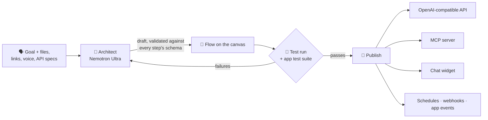

**Models by role.** Code asks for a role; the model ids live only in config. One gateway meters cost, enforces spending caps and falls back to other providers.

| Role | Model (Nebius Token Factory) | Used for |
|---|---|---|
| Architect | **Nemotron 3 Ultra** | Goal → flow, repairs, Refine diffs |
| Agent | **Nemotron 3.5 Super** | Agents, writing steps, safety checks |
| Fast | **Nemotron 3 Nano** | Routing, classification, extraction, test judging |
| Embed | **Qwen3 Embedding 8B** | Knowledge search (vectors + full text) |

## 🔌 What it connects to

| Works for real | Preview only (needs each platform's app approval) |
|---|---|
| Gmail · Google Sheets · Google Drive · YouTube · Slack · Discord · Telegram · Bluesky · Shopify · Notion · Airtable · HubSpot · any REST or OpenAPI service · websites (Tavily) | Instagram · TikTok · LinkedIn · X |

Plus **68 step types**: AI (agent, classify, extract, write, summarise, translate, describe image, transcribe, generate video, voice and image), knowledge, logic (if, router, loop, merge), media (merge audio and video, cut clips for Reels and Shorts, captions, resize, thumbnail), data, human approval and outputs. See [docs/NODES.md](docs/NODES.md).

## 🚀 Run it locally

You need Rust (stable), Node 22+ with pnpm, and ffmpeg.

```bash
git clone https://github.com/spark-456/interlock && cd interlock
cp config/interlock.example.toml config/interlock.toml
pnpm -C web install
cargo xtask dev
```

Open http://localhost:5173. Set keys as environment variables, never in files:

| Variable | For |
|---|---|
| `NEBIUS_API_KEY` | Nemotron and embeddings on Nebius Token Factory |
| `IL_MASTER_KEY` | Encrypting saved credentials (base64 of 32 random bytes) |
| `TAVILY_API_KEY` | Reading websites into knowledge bases |
| `GOOGLE_CLIENT_ID`, `GOOGLE_CLIENT_SECRET`, `GOOGLE_REDIRECT_URI` | Gmail, Sheets, Drive, YouTube |
| `OPENROUTER_API_KEY`, `GROQ_API_KEY` | Optional model fallbacks |

No keys at all? `pnpm -C web dev` with `VITE_FIXTURES=1` runs the whole UI on recorded data, and every test runs offline with `IL_PROVIDERS=fake`.

## 🤖 Use it from Claude Code or Codex

Create an API key in Settings, then:

```bash
claude mcp add --transport http interlock http://localhost:8080/mcp --header "Authorization: Bearer $INTERLOCK_KEY"
```

```toml
# Codex: ~/.codex/config.toml
[mcp_servers.interlock]
url = "http://localhost:8080/mcp"
bearer_token_env_var = "INTERLOCK_KEY"
```

Then ask: *"Build a support agent from ./docs/faq.pdf and add it as a chat panel in this app."* Local files are uploaded with one `curl` to `/mcp/files`, and the tool descriptions show the command.

## 🏗️ Architecture

One Rust binary serves the API and the embedded web app, and deploys as a single Docker image ([deploy/](deploy/README.md)).

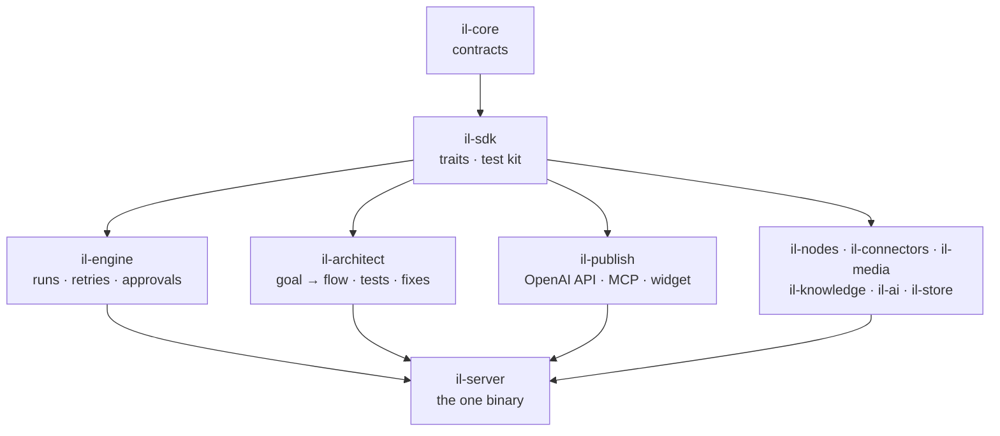

- **Self-registering parts.** Nodes, connectors, providers and routes register themselves; there is no central list to edit.
- **The manifest is the interface.** The palette, settings forms, architect catalog and docs all come from each step's JSON Schema.
- **Safe by default.** Test runs never send or post. Outbound HTTP blocks private networks. Credentials are encrypted at rest and never reach the browser. Risky API operations are skipped unless you allow them.
- **About 58,000 lines** across 12 crates and the SvelteKit app, with **490 tests**, all offline.

<details>
<summary><b>Repository map</b></summary>

| Path | What's there |
|---|---|
| `crates/` | The Rust workspace (one crate per module) |
| `web/` | SvelteKit + Svelte 5 front end, Svelte Flow canvas |
| `prompts/` | Prompts for the architect and AI steps |
| `fixtures/` | Templates, recorded runs and sample files for the demo |
| `migrations/` | SQLite migrations, prefixed by module |
| `design/` | The visual design and tokens |
| `docs/` | Product spec (`PRD.md`), task board, node catalog |
| `xtask/` | `cargo xtask dev / check / gen-types / catalog` |

</details>

## 🏆 Built for

The **Nebius × NVIDIA Global AI Hackathon** (October 2026). Interlock builds on ideas from our earlier project, Tilo, with a new codebase, design and feature set.

## 📄 License

[Apache 2.0](LICENSE)
