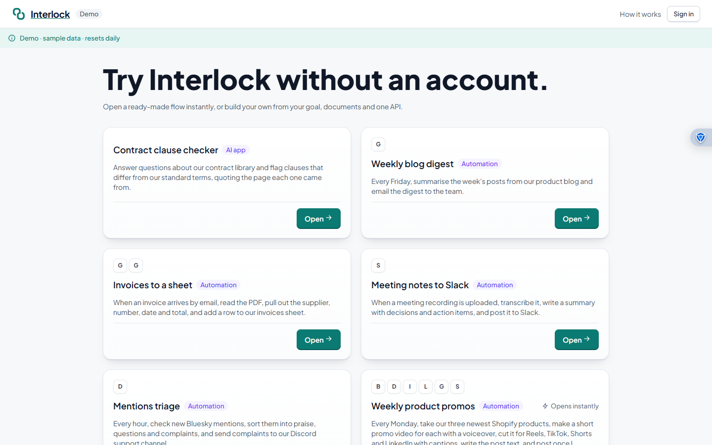
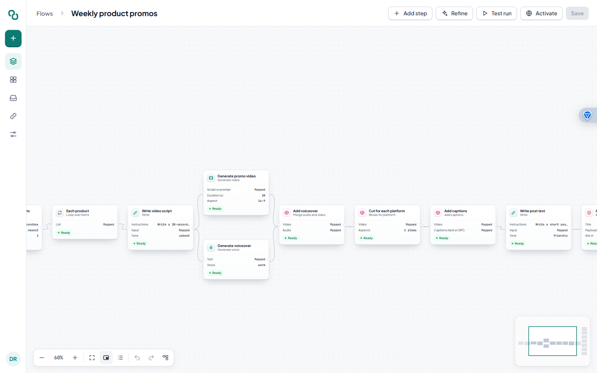
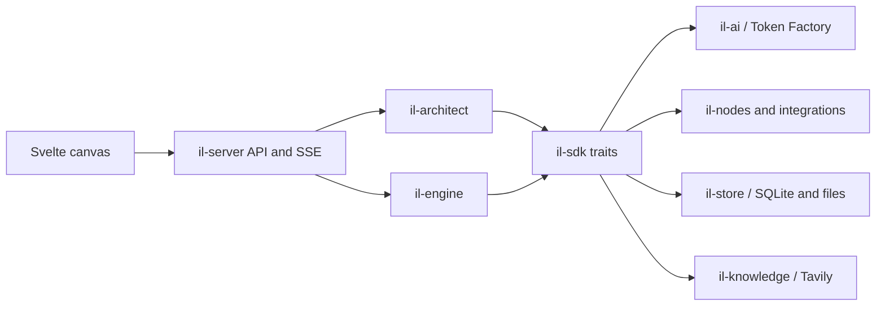

# Interlock

**Describe it. Interlock builds it. You can change anything.**

Interlock turns a request into an editable backend workflow. Start with a sentence or a seeded template, inspect the resulting nodes, run it with live events, and publish the flow as an automation, API, MCP endpoint or chat widget. The canvas keeps the generated workflow visible so you can change its logic before publishing.

Built for the Nebius × NVIDIA Global AI Hackathon, Best Apps and Agents track. Interlock builds on ideas from our earlier project Tilo, with a new codebase, design and feature set.

**Demo:** Public URL pending deployment. The local demo works without a sign-in using `POST /api/demo/session` and seeded templates. The deployment checklist is in [PRD §13](docs/PRD.md#13-hackathon-compliance-checklist).

## See it

These screenshots show the running UI with local fixture data. Public deployment screenshots will replace them after verification.







`il-core` defines shared contracts; `il-sdk` defines the interfaces and test fakes; implementation crates supply services. Only `il-server` wires concrete implementations together. Nodes and API route groups self-register, and the [node catalog](docs/NODES.md) is generated from manifests.

## Run locally

Install Rust stable, Node.js 22 or newer with pnpm 10, and ffmpeg. On Windows use the MSVC Rust toolchain and Visual Studio C++ Build Tools. See [AGENTS.md §1](AGENTS.md#1-setup) for platform-specific installation commands.

```powershell
git clone https://github.com/spark-456/interlock.git
cd interlock
pnpm -C web install
Copy-Item config/interlock.example.toml config/interlock.toml
$env:IL_PROVIDERS = 'fake'
cargo xtask check
cargo xtask dev
```

On Linux or macOS, after installing the same prerequisites:

```sh
git clone https://github.com/spark-456/interlock.git
cd interlock
pnpm -C web install
cp config/interlock.example.toml config/interlock.toml
IL_PROVIDERS=fake cargo xtask check
IL_PROVIDERS=fake cargo xtask dev
```

The web dev server and API start together; `cargo xtask dev` prints their local URLs. Fake mode needs no paid account or API keys. To test only the UI, run `pnpm -C web dev:fixtures`. Never put secrets in `config/interlock.toml`; use environment variables such as `NEBIUS_API_KEY`, `TAVILY_API_KEY` and the base64 `IL_MASTER_KEY` for real integrations.

## Models and external data

The three model roles are configured in [`config/interlock.example.toml`](config/interlock.example.toml), not hardcoded into nodes. [`crates/il-ai/src/gateway.rs`](crates/il-ai/src/gateway.rs) routes each role through the [Nebius Token Factory adapter](crates/il-ai/src/providers/tokenfactory/mod.rs):

| NVIDIA model | Role | Where it runs |
| --- | --- | --- |
| Nemotron 3 Ultra | `architect` | [`crates/il-architect/src/compile/`](crates/il-architect/src/compile/) builds flows; [`crates/il-architect/src/ask/`](crates/il-architect/src/ask/) edits them conversationally |
| Nemotron 3 Super | `agent` | [`crates/il-nodes/src/ai/agent.rs`](crates/il-nodes/src/ai/agent.rs) and [`write.rs`](crates/il-nodes/src/ai/write.rs) |
| Nemotron 3 Nano | `fast` | [`classify.rs`](crates/il-nodes/src/ai/classify.rs), [`extract.rs`](crates/il-nodes/src/ai/extract.rs) and other fast AI nodes |

The [Tavily crawl client](crates/il-knowledge/src/crawl/mod.rs) fetches website content for [knowledge ingestion](crates/il-knowledge/src/ingest/mod.rs). It caps pages per source and requires `TAVILY_API_KEY` for real calls. Tests use fakes and local HTTP mocks.

## Deployment and limits

The intended Nebius deployment is a container with HTTPS, persistent `/data` storage and an external secrets file. The deployment branch contains a Dockerfile, Compose/Caddy setup, runbook and smoke script; the public instance is pending. `config/interlock.example.toml` sets global, workspace, flow and run spending caps. Demo sessions use lower caps and recorded media.

The current local demo can use fake models and recorded outputs. Real model calls require a Token Factory key; website ingestion requires a Tavily key. Media adapters have not been live-tested. A public demo URL and runtime screenshots will be added after deployment is verified. See [PRD §13](docs/PRD.md#13-hackathon-compliance-checklist) for the remaining submission checks.

## License

The current public repository is all rights reserved; see [LICENSE](LICENSE). The project owner plans to switch to Apache-2.0 at submission.
